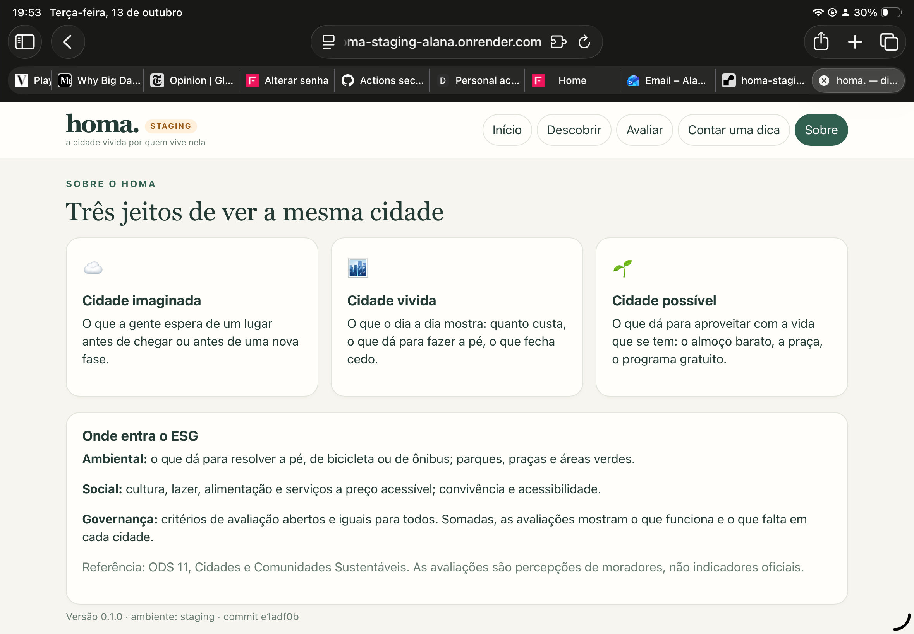

# Projeto - Cidades ESG Inteligentes

## homa.

**Qual é o seu momento agora, e o que a sua cidade tem para isso?**

O Homa reúne dicas e avaliações de quem mora na cidade, organizadas pelo momento de vida de cada pessoa: quem está chegando por trabalho, estudo ou concurso; quem mudou de vida sem mudar de cidade (virou pai ou mãe, trocou de bairro, ficou sem carro); e quem só quer sair do automático sem gastar muito. Moradores contam o que funciona (o prato feito bom e barato, a praça com sombra, o programa de graça) e avaliam a cidade em cinco dimensões de qualidade de vida.

**Onde entra o ESG:** mobilidade a pé e espaços verdes (Ambiental); acesso a cultura, lazer e alimentação a preço acessível (Social); critérios de avaliação abertos e iguais para todos, com a soma das percepções dos moradores mostrando o que funciona e o que falta em cada cidade (Governança). Referência: ODS 11.

| Ambiente | URL |
|---|---|
| Staging | https://homa-staging-alana.onrender.com |
| Produção | https://homa-prod-alana.onrender.com |

**Integrante:** Alana de Menezes Pereira – RM 562562

> **Nota ao professor**
>
> No meio da realização deste trabalho, meu notebook pifou. Acabei não conseguindo validar a conta Azure de estudante, porque várias coisas que eu precisava estavam salvas no notebook. Então fiz o que dava para finalizar o deploy com o GitHub e com o Render, entre o tablet e o celular. O pipeline, a imagem Docker e a aprovação manual da produção são os mesmos que eu tinha planejado para a Azure; só mudou o lugar onde a aplicação roda.


---

## Como executar localmente com Docker

Pré-requisitos: Docker e Docker Compose.

```bash
# 1. Clonar o repositório
git clone [URL DO REPOSITÓRIO]
cd homa

# 2. Criar o arquivo de variáveis a partir do exemplo
cp .env.example .env

# 3. Subir aplicação + banco
docker compose up --build -d

# 4. Conferir
docker compose ps
curl http://localhost:8080/actuator/health
curl http://localhost:8080/api/info
```

A interface fica em **http://localhost:8080**.

Para parar: `docker compose down` (os dados continuam no volume `homa-db-data`). Para apagar também os dados: `docker compose down -v`.

**Sem Docker** (só Java 21 e Maven): `mvn spring-boot:run`. Sem `DB_URL`, a aplicação usa H2 em memória.

### Endpoints da API

| Método | Rota | O que faz |
|---|---|---|
| GET | `/api/dicas?cidade=Passo Fundo&categoria=COMIDA&bairro=Centro&gratuita=true` | Lista dicas da cidade (filtros opcionais) |
| POST | `/api/dicas` | Cadastra uma dica |
| GET | `/api/avaliacoes?cidade=Passo Fundo` | Lista avaliações da cidade |
| GET | `/api/avaliacoes/resumo?cidade=Passo Fundo` | Média das cinco dimensões e comentários recentes |
| POST | `/api/avaliacoes` | Cadastra uma avaliação (notas de 1 a 5) |
| GET | `/api/info` | Ambiente, versão e commit publicado |
| GET | `/actuator/health` | Health check |
| GET | `/swagger-ui.html` | Documentação interativa da API (Swagger) |

Exemplo:

```bash
curl -X POST http://localhost:8080/api/dicas -H "Content-Type: application/json" -d '{
  "cidade": "Passo Fundo", "bairro": "Centro", "categoria": "COMIDA", "gratuita": false,
  "titulo": "O prato feito que salva a semana",
  "descricao": "Comida caseira por um preço justo, aberto até as 14h."
}'
```

Categorias: `COMIDA`, `CULTURA`, `FAMILIA`, `ESPACOS`, `SERVICOS`.

---

## Pipeline CI/CD

**Ferramenta:** GitHub Actions (`.github/workflows/ci-cd.yml`). **Registro de imagens:** Docker Hub. **Hospedagem:** Render (Web Services a partir da imagem do Docker Hub), com um serviço para staging e outro para produção. O plano original era o Azure App Service; o motivo da troca está em *Por que Render e não Azure*.

### Fluxo de branches

`feature/*` → pull request para `develop` → merge em `develop` (deploy em **staging**) → pull request para `main` → merge em `main` (deploy em **produção**, com aprovação).

Todo pull request roda build e testes antes do merge: se um teste falha, o merge não deve ser feito.

### Etapas

| Etapa | Job | Quando roda | O que acontece |
|---|---|---|---|
| 1 | Build e testes | sempre | Java 21 + `mvn verify`: compila e roda os testes automatizados (JUnit + MockMvc). Os relatórios e o `.jar` ficam guardados como artefato. |
| 2 | Imagem Docker | sempre (`needs: build-test`) | Monta a imagem, sobe um container e confere `/actuator/health`. Em push, publica no Docker Hub com a tag do **SHA do commit** e o nome da branch. |
| 3 | Deploy em staging | push na `develop` | Chama o *deploy hook* do Render com a imagem do commit (`imgURL`), e o serviço de staging passa a rodar essa imagem. O script `aguardar-deploy.sh` espera `/api/info` responder com o mesmo commit. |
| 4 | Deploy em produção | push na `main` | Espera **aprovação manual** (environment `production` com *required reviewer*). Depois de aprovado, chama o deploy hook do serviço de produção e confere da mesma forma. |

Os jobs dependem uns dos outros (`needs`): sem testes aprovados não há imagem, e sem imagem não há deploy.

### Por que Render e não Azure

O projeto foi planejado para o Azure App Service, com dois Web Apps no plano gratuito F1. Na reta final meu notebook pifou e não consegui validar a conta Azure de estudante, porque o que eu precisava para isso estava salvo nele.

Para não deixar o deploy de fora, os dois ambientes foram publicados no Render, que tem plano gratuito e roda a mesma imagem do Docker Hub. O resto do pipeline não mudou: build, testes, imagem e a conferência do commit em `/api/info` são os mesmos. A troca de nuvem ficou restrita ao passo que dispara o deploy.

**Entrega contínua:** tudo é automático até a produção, e a última etapa depende de uma aprovação manual. Se o deploy em produção fosse automático a cada alteração aprovada nos testes, o pipeline seria de implantação contínua.

### Segredos e variáveis (GitHub → Settings)

Nenhuma credencial fica no código: tudo vai em GitHub Secrets ou em variáveis de ambiente.

| Nome | Tipo | Onde | Para quê |
|---|---|---|---|
| `DOCKERHUB_USERNAME` | secret | repositório | usuário do Docker Hub |
| `DOCKERHUB_TOKEN` | secret | repositório | token de acesso do Docker Hub |
| `RENDER_DEPLOY_HOOK_STAGING` | secret | environment `staging` | deploy hook do serviço de staging no Render |
| `RENDER_DEPLOY_HOOK_PRODUCTION` | secret | environment `production` | deploy hook do serviço de produção no Render |
| `STAGING_URL` | variável | environment `staging` | URL do serviço de staging |
| `PRODUCTION_URL` | variável | environment `production` | URL do serviço de produção |

### Configuração de cada serviço no Render

Cada ambiente é um Web Service do tipo *Existing Image*, no plano Free, apontando para `docker.io/<usuario>/homa`. A única variável é `APP_ENV` (`staging` ou `producao`). A porta vem da variável `PORT` que o Render define, e a aplicação já lê essa variável.

### Decisões

- **Plano gratuito do Render:** suficiente para demonstração. O serviço hiberna sem acesso, então a primeira abertura depois de um tempo parado demora cerca de um minuto.
- **Banco:** localmente, o Compose usa PostgreSQL. Na nuvem, cada ambiente usa H2 em memória, o que mantém staging e produção isolados sem custo; os dados de exemplo são recriados a cada início. A aplicação troca de banco só pela variável `DB_URL`, e um PostgreSQL gerenciado fica como próximo passo.
- **Estratégia de deploy:** o Render sobe a nova imagem e só troca o tráfego quando ela responde, e o pipeline confere em `/api/info` se o commit no ar é o que acabou de ser publicado.

### Rollback

Toda imagem fica no Docker Hub com a tag do SHA do commit. Para voltar uma versão:
1. Rodar de novo, em Actions, o workflow de um commit anterior que funcionava (*Re-run jobs*); ou
2. No painel do Render, em **Events**, usar *Rollback* para um deploy anterior.

### Monitoramento

- Execução e logs de cada job: aba **Actions** do GitHub, com resumo dos testes e da imagem publicada.
- Logs do container e do deploy: abas **Events** e **Logs** de cada serviço no Render.
- Saúde da aplicação: `/actuator/health`. Versão publicada: `/api/info`.

### Documentação da API

Swagger UI em `/swagger-ui.html`, com a especificação OpenAPI em `/v3/api-docs`.

---

## Containerização

### Dockerfile

```dockerfile
# ---------- Etapa 1: build ----------
FROM maven:3.9-eclipse-temurin-21 AS build
WORKDIR /app
COPY pom.xml .
RUN mvn -B -q dependency:go-offline
COPY src ./src
RUN mvn -B -q package -DskipTests

# ---------- Etapa 2: runtime ----------
FROM eclipse-temurin:21-jre-alpine
WORKDIR /app
RUN addgroup -S homa && adduser -S homa -G homa
COPY --from=build /app/target/homa.jar app.jar
USER homa
ARG GIT_COMMIT=desconhecido
ENV GIT_COMMIT=${GIT_COMMIT} \
    PORT=8080 \
    JAVA_OPTS="-XX:MaxRAMPercentage=75"
EXPOSE 8080
HEALTHCHECK --interval=30s --timeout=5s --start-period=60s --retries=3 \
  CMD wget -qO- http://localhost:${PORT}/actuator/health | grep -q UP || exit 1
ENTRYPOINT ["sh", "-c", "exec java $JAVA_OPTS -jar app.jar"]
```

**Estratégias adotadas:**

- **Multi-stage build:** o Maven e o JDK ficam só na etapa de build. A imagem final leva apenas o JRE Alpine e o `.jar`.
- **Cache de dependências:** o `pom.xml` é copiado antes do código, então as dependências só são baixadas de novo quando ele muda.
- **Usuário sem privilégios:** o container não roda como root.
- **Health check** em `/actuator/health`, usado pelo Docker e pelo pipeline.
- **Commit gravado na imagem** (`GIT_COMMIT`), exposto em `/api/info`, para confirmar qual versão está em cada ambiente.
- **Configuração por variáveis de ambiente** (porta, banco, ambiente), sem nada fixo no código.

### Docker Compose

`docker-compose.yml` sobe dois serviços:

- **db:** PostgreSQL 16, com health check (`pg_isready`).
- **app:** a aplicação, que só sobe depois que o banco está saudável (`depends_on: condition: service_healthy`).

Os dois serviços usam a **rede** `homa-net` (bridge) e o **volume** nomeado `homa-db-data`, onde ficam os dados do Postgres. As **variáveis de ambiente** vêm do arquivo `.env` (modelo em `.env.example`).

---

## Prints do funcionamento

> Prints em `docs/prints/`.

**Staging** (`https://homa-staging-alana.onrender.com`), com o rodapé mostrando ambiente e commit:



**Produção** (`https://homa-prod-alana.onrender.com`):


O print do `docker compose` rodando localmente não foi feito porque eu estava sem computador na reta final; o Compose foi testado durante o desenvolvimento.

---

## Tecnologias utilizadas

- **Java 21** e **Spring Boot 3.3**: Web, Data JPA, Validation, Actuator
- **springdoc-openapi** (Swagger UI)
- **PostgreSQL 16** (local, via Compose) e **H2** (testes e ambientes na nuvem)
- **JUnit 5** e **MockMvc** (testes automatizados)
- **Docker** (multi-stage) e **Docker Compose**
- **GitHub Actions** (CI/CD) e **Docker Hub** (registro de imagens)
- **Render** (Web Services com imagem Docker), plano Free, para staging e produção
- **HTML, CSS e JavaScript** puros na interface, servidos pela própria aplicação

---

## Checklist de entrega

| Item | OK |
|---|---|
| Projeto compactado em .ZIP com estrutura organizada | ☐ |
| Dockerfile funcional | ☐ |
| docker-compose.yml ou arquivos Kubernetes | ☐ |
| Pipeline com etapas de build, teste e deploy | ☐ |
| README.md com instruções e prints | ☐ |
| Documentação técnica com evidências (PDF ou PPT) | ☐ |
| Deploy realizado nos ambientes staging e produção | ☐ |
